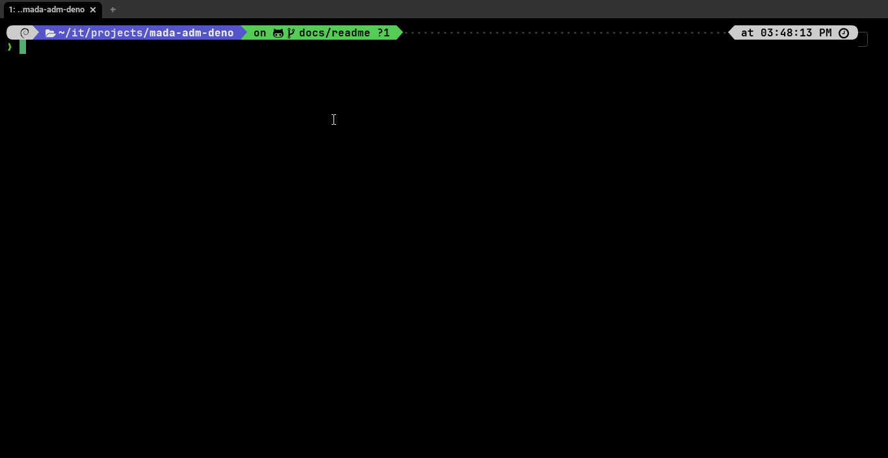
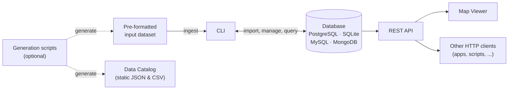

# Mada ADM

[Madagascar's administrative subdivisions](https://en.wikipedia.org/wiki/Subdivisions_of_Madagascar)
as a usable dataset: import it, query it, map it, browse it.



## Overview

Getting
[Madagascar's administrative subdivisions](https://en.wikipedia.org/wiki/Subdivisions_of_Madagascar)
into a usable form is harder than it should be:

- **Access is sometimes restricted.** The data can be locked behind specific
  websites, or be inconsistent and hard to find.
- **The formats demand GIS expertise.** It typically ships as shapefiles or
  GeoJSON, which assume familiarity with GIS tools just to open and inspect.
- **Even in code, it isn't ready to use.** Parsing those files programmatically
  still leaves you to write your own ETL to turn flat geospatial features into a
  clean, hierarchical dataset.

Mada ADM removes those obstacles. It provides the data already structured as a
hierarchy ([province](https://en.wikipedia.org/wiki/Provinces_of_Madagascar) →
[region](https://en.wikipedia.org/wiki/Regions_of_Madagascar) →
[district](https://en.wikipedia.org/wiki/Districts_of_Madagascar) →
[commune](https://fr.wikipedia.org/wiki/Commune_(Madagascar)) →
[fokontany](https://fr.wikipedia.org/wiki/Fokontany)) and the tools to put it to
work, with no GIS desktop software or custom ETL required:

- **Import** it into [PostgreSQL](https://www.postgresql.org/),
  [SQLite](https://www.sqlite.org/), [MySQL](https://www.mysql.com/), or
  [MongoDB](https://www.mongodb.com/) with a CLI, with geometry optionally
  included.
- **Query** it from any application through a REST API.
- **Visualize** it on an interactive map, and pin your own custom locations.
- **Browse** it in a data catalog, organized by hierarchy, with no geometry.

Everything is built with [Deno](https://deno.com/) as a single
[workspace](https://docs.deno.com/runtime/fundamentals/workspaces/). Each tool
can be used on its own and is documented in its own README.

## Components

All components share the same dataset and can be used independently or together:

| Component        | What it does                                                                                                                                                                          | Docs                                |
| ---------------- | ------------------------------------------------------------------------------------------------------------------------------------------------------------------------------------- | ----------------------------------- |
| **CLI**          | Imports the administrative data, with geometry optionally included, into PostgreSQL, SQLite, MySQL, or MongoDB. Sub-commands manage the imported data and query it from the terminal. | [`/commands`](./commands)           |
| **REST API**     | Exposes the data imported into the database to HTTP clients, so any application can query it.                                                                                         | [`/rest-api`](./rest-api)           |
| **Map Viewer**   | Single-page web app that consumes the REST API to display the data on a map. It also lets you pin custom locations.                                                                   | [`/map-viewer`](./map-viewer)       |
| **Data Catalog** | Static JSON and CSV files (no geometry), organized in one folder per administrative level.                                                                                            | [`/data/catalogs`](./data/catalogs) |

## How the pieces fit together

The dataset ships already formatted for ingestion, so the CLI loads it into your
database as is. The REST API serves what is in that database, and the Map Viewer
is a client of the API. The Data Catalog is a set of static files that doesn't
depend on any of the other components.

Both the dataset and the catalog are generated by scripts in this repository.
You don't need to run them to use the project. Run them only if you want to
modify the base dataset, then import your altered version into a database or
build an altered catalog from it.



- **Dataset → CLI → Database:** the starting point for most workflows. The CLI
  ingests the ready-made data, with geometry optionally included, and also
  manages and queries it from the terminal.
- **Database → REST API → Map Viewer:** the API serves what is in your database
  over HTTP, and the Map Viewer consumes the API.
- **Database → REST API → clients:** the API serves what is in your database
  over HTTP to any HTTP client. The Map Viewer is one of those clients.
- **Data Catalog:** standalone. Use the files directly, with no database, API,
  or tooling.
- **Generation scripts (dotted):** optional. Run them on your own inputs to
  produce altered versions of the dataset and the catalog.

## Quick start

### Prerequisites

**Required**

- [Deno](https://deno.com) 2.9+
- [Git](https://git-scm.com) and [Git LFS](https://git-lfs.com), needed to fetch
  the dataset files
- A supported database (pick one). Geospatial support is only needed if you
  import geometry:

| Database                                  | Minimum version | Geospatial requirement                                                     |
| ----------------------------------------- | --------------- | -------------------------------------------------------------------------- |
| [PostgreSQL](https://www.postgresql.org/) | 8.4             | [PostGIS](https://postgis.net/) extension                                  |
| [SQLite](https://www.sqlite.org/)         | 3.0             | [SpatiaLite](https://www.gaia-gis.it/fossil/libspatialite/index) extension |
| [MySQL](https://www.mysql.com/)           | 5.7             | Built-in spatial types                                                     |
| [MongoDB](https://www.mongodb.com/)       | 2.4             | Built-in GeoJSON / 2dsphere                                                |

> [!IMPORTANT]
> You are responsible for installing and configuring the database and its
> spatial extensions correctly before using the CLI.

**Optional**

- [Redis](https://redis.io) 8.x+: the CLI's import pipeline uses
  [Redis Streams](https://redis.io/docs/latest/develop/data-types/streams/) to
  distribute work across parallel workers. It is enabled by default; to run
  without it, pass the `--disable-redis` flag. Without Redis, the import
  pipeline runs entirely in memory, so the work can't be resumed after an
  interruption.
- [Docker](https://www.docker.com): run the CLI, SQLite with SpatiaLite, and
  Redis as pre-packaged containers, so you don't need to install Deno, SQLite,
  SpatiaLite, or Redis on your machine.

### Steps

1. **Clone the repository**

   ```sh
   git clone git@github.com:tech-AmazingTool/mada-adm-deno.git
   cd mada-adm-deno
   ```

   > [!WARNING]
   > Install Git LFS before cloning. Otherwise the data files will be small
   > pointer files. If that happens, run `git lfs pull`.

2. **Install the dependencies**

   ```sh
   deno install
   ```

3. **Import the data into SQLite**

   ```sh
   deno task cli
   ```

   SQLite is the default database. Optional flags:

   - `--disable-redis`: run without Redis (the import then can't be resumed)
   - `--processing-workers-count=<n>`: number of parallel workers (default:
     `2`), increase for faster imports
   - `--queue-batch-size=<n>`: number of records per batch during the data
     integration pipeline (default: `1`), increase for faster imports

   The CLI expects Redis at `localhost:6379`. If yours runs elsewhere, set the
   `REDIS_URL` environment variable:

   ```sh
   REDIS_URL="redis://<host>:<port>" deno task cli
   ```

   The import doesn't start right away. The CLI first walks you through an
   interactive wizard: database schema configuration, administrative level
   tables creation, and resuming the previous job's context or starting fresh.
   On your first run, follow the prompts and accept the defaults.

   See the [CLI README](./cli/README.md) for the full documentation on the
   wizard, the Redis configuration, and these flags.

4. **Verify the import**

   Once the import finishes, query the province named "Antananarivo":

   ```sh
   deno task cli:query "antananarivo" --level province
   ```

   The output includes the following record:

   ```text
   {
     "id": <id>,
     "province": "Antananarivo",
     "createdAt": <timestamp>,
     "updatedAt": <timestamp>
   }
   ```

   If the query returns nothing, the import probably didn't finish. Run
   `deno task cli` again and choose to resume the previous job or restart from
   scratch.

#### Using Docker instead

Docker replaces steps 2 to 4. The Compose setup provides Deno and its
dependencies, SQLite with SpatiaLite, and Redis, so you don't install any of
them on your machine. It is also preconfigured, including the Redis connection,
so you don't need to set any environment variables or create a `.env` file.

1. Build and start the services from the root of the repository

   ```sh
   docker compose up -d
   ```

2. Run the import wizard inside the `app` service

   ```sh
   docker compose exec app deno task cli
   ```

   The wizard is interactive, so run it from a terminal. Redis is already part
   of the setup, so you don't need `--disable-redis`.

3. Verify the import

   ```sh
   docker compose exec app deno task cli:query "antananarivo" --level province
   ```

   The expected output and the empty-result advice are the same as in step 4
   above.

Any other CLI command works the same way: prefix it with
`docker compose exec app`.

### Next steps

The data is now in your database. From here:

- **Explore the CLI.** Manage the imported data and query it with the other
  commands in the [CLI README](./cli/README.md).
- **Serve it over HTTP.** Start the [REST API](./rest-api) in dev mode to query
  the data from any HTTP client:

  ```sh
  deno task rest-api:dev
  ```

  It listens on port 8000 by default. To use another port, set the
  `REST_API_PORT` environment variable:

  ```sh
  REST_API_PORT=3000 deno task rest-api:dev
  ```
- **See it on a map.** With the API running, start the
  [Map Viewer](./map-viewer) in dev mode in a second terminal and pin your own
  locations:

  ```sh
  deno task map-viewer:dev
  ```

  It expects the API at `http://localhost:8000`. If you changed the API's host
  or port, set the `VITE_PUBLIC_REST_API_BASE_URL` environment variable to
  match:

  ```sh
  VITE_PUBLIC_REST_API_BASE_URL="http://localhost:3000" deno task map-viewer:dev
  ```
- **Need just names and hierarchy?** Grab the CSV and JSON files from the
  [Data Catalog](./data/catalogs) to fill dropdowns, spreadsheets, or lookups,
  without importing anything.

Both the REST API and the Map Viewer also have a production mode after a build.
See their READMEs for details.

## Repository layout

This repository is a Deno workspace. The CLI, the REST API, the Map Viewer and
the Data Catalog each live in their own folder with their own README, backed by
shared code for databases, queries and Redis.

```text
mada-adm-deno/
├── commands/         # CLI: import, manage and query the data
├── rest-api/         # REST API serving the imported data over HTTP
├── map-viewer/       # Map Viewer web app (SPA) built on the REST API
├── data/
│   ├── catalogs/     # Data Catalog: static JSON and CSV files
│   ├── inputs/       # Pre-formatted input dataset ingested by the CLI
│   ├── ndjson/       # Original dataset in NDJSON, used to derive the inputs
│   └── geojson/      # Placeholder for the original GeoJSON files (HDX dataset)
├── scripts/          # Generation scripts for the input dataset and the catalog
├── db/               # Database abstractions and local files
├── adapters/         # Per-database implementations of those abstractions
│   ├── postgres/
│   ├── mysql/
│   ├── mongo/
│   └── sqlite/
├── queries/          # Queries shared by the CLI and the REST API
├── redis/            # Redis-related code and local files
├── bin/              # Compiled CLI binaries for different platforms
├── consts/           # Global constants
├── helpers/          # Project-specific helper functions used across the project
├── lib/              # Self-contained libraries implemented inside the project
├── types/            # Global TypeScript types
├── utils/            # Neutral utilities (dates, strings, ...)
├── diagrams/         # Draft diagrams and blueprints of the project
├── readme-images/    # Images used by the READMEs
├── .github/          # GitHub workflows
├── .agents/          # AI agent rules and skills
├── .env.example      # Reference of all supported environment variables
├── docker-compose.yml
├── deno.json         # Workspace configuration, global dependencies, root tasks
├── LICENCE           # Code license (MIT)
├── LICENCE-DATA      # Dataset license (ODbL)
├── README.md
└── ...               # Other files and folders
```

Each component folder has its own README: [`commands`](./commands),
[`rest-api`](./rest-api), [`map-viewer`](./map-viewer) and
[`data/catalogs`](./data/catalogs).

## Development

This section covers workspace-level tasks. Component-specific development notes
are in each component's README.

### Setup

1. Install [Deno](https://deno.com) 2.9+, [Git](https://git-scm.com) and
   [Git LFS](https://git-lfs.com).
2. Clone the repository and install the dependencies of every workspace member:

   ```sh
   git clone https://github.com/<owner>/mada-adm-deno.git
   cd mada-adm-deno
   deno install
   ```

3. Copy `.env.example` to `.env` and adjust it if needed:

   ```sh
   cp .env.example .env
   ```

### Root tasks

Run `deno task` with no arguments to list every task.

**CLI**

| Task                          | Description                               |
| ----------------------------- | ----------------------------------------- |
| `deno task cli`               | Run the import wizard                     |
| `deno task cli:manage-config` | Manage the database schema configurations |
| `deno task cli:update-field`  | Update a field of the imported data       |
| `deno task cli:clear`         | Clear the imported data                   |
| `deno task cli:query`         | Query the imported data                   |

**REST API**

| Task                       | Description                              |
| -------------------------- | ---------------------------------------- |
| `deno task rest-api:dev`   | Start the REST API in dev mode           |
| `deno task rest-api:build` | Build the REST API for production        |
| `deno task rest-api:start` | Run the production build of the REST API |

**Map Viewer**

| Task                           | Description                             |
| ------------------------------ | --------------------------------------- |
| `deno task map-viewer:dev`     | Start the Map Viewer in dev mode        |
| `deno task map-viewer:build`   | Build the Map Viewer for production     |
| `deno task map-viewer:preview` | Preview the Map Viewer production build |

**Binaries**

| Task                            | Description                                                           |
| ------------------------------- | --------------------------------------------------------------------- |
| `deno task compile`             | Compile the CLI for the current platform into `bin/current-platform/` |
| `deno task compile:all`         | Compile for all six targets (Windows, macOS, Linux; x86_64 and arm64) |
| `deno task compile:<os>:<arch>` | Compile for one target, for example `compile:linux:arm64`             |

**Data generation**

| Task                           | Description                                    |
| ------------------------------ | ---------------------------------------------- |
| `deno task extract-adm-inputs` | Regenerate the input dataset in `data/inputs`  |
| `deno task generate-catalogs`  | Regenerate the Data Catalog in `data/catalogs` |

Compiled binaries are written to `bin/<target>/mada-adm` and embed `data/inputs`
and the import workers.

### Tests

```sh
deno task <test>
```

> [!IMPORTANT]
> The tests need a running Redis instance, with its connection parameters
> supplied as environment variables (for example in your `.env` file). The
> integration test of the CLI's import command requires it.

### Formatting and linting

```sh
deno fmt
deno lint
```

### Databases and Redis for development

Use the [Docker Compose setup](#using-docker-instead) to run the databases and
Redis locally without installing them. See the [CLI README](./commands) for
per-database configuration.

### Workspace conventions

- Code shared across components lives at the root, not inside a component.
  Before adding code to a component, check whether it belongs in one of these
  folders instead:
  - Data access: `db/` (abstractions), `adapters/` (one implementation per
    database) and `queries/` (queries shared by the CLI and the REST API).
    Changing an abstraction usually means updating every adapter.
  - Redis: `redis/`.
  - General-purpose code: `consts/`, `helpers/`, `lib/`, `types/` and `utils/`.
- Rules and skills for AI coding agents live in [`.agents/`](./.agents).
- CI workflows live in [`.github/`](./.github).
